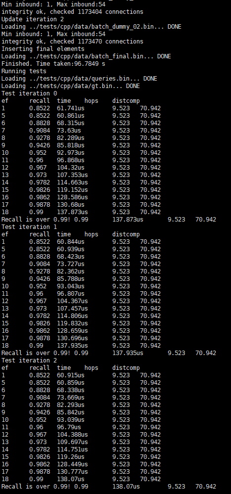

# Installation Guide

## Verified Environments

To use hnswlib smoothly and securely, ensure that your environment is one of the verified environments.

**Table 1** Verified hnswlib environments<a id="verified-hnswlib-environments"></a>

<a name="table59918346913"></a>
<table><thead align="left"><tr id="zh-cn_topic_0000002483307829_row1169294312212"><th class="cellrowborder" valign="top" width="16.93830616938306%" id="mcps1.2.8.1.3"><p id="zh-cn_topic_0000002483307829_p12692144313211"><a name="zh-cn_topic_0000002483307829_p12692144313211"></a><a name="zh-cn_topic_0000002483307829_p12692144313211"></a>OS</p>
</th>
<th class="cellrowborder" valign="top" width="15.468453154684534%" id="mcps1.2.8.1.4"><p id="zh-cn_topic_0000002483307829_p06926438214"><a name="zh-cn_topic_0000002483307829_p06926438214"></a><a name="zh-cn_topic_0000002483307829_p06926438214"></a>CPU</p>
</th>
<th class="cellrowborder" valign="top" width="10.63893610638936%" id="mcps1.2.8.1.5"><p id="zh-cn_topic_0000002483307829_p269284310216"><a name="zh-cn_topic_0000002483307829_p269284310216"></a><a name="zh-cn_topic_0000002483307829_p269284310216"></a>Memory</p>
</th>
<th class="cellrowborder" valign="top" width="13.468653134686532%" id="mcps1.2.8.1.6"><p id="zh-cn_topic_0000002483307829_p196922434215"><a name="zh-cn_topic_0000002483307829_p196922434215"></a><a name="zh-cn_topic_0000002483307829_p196922434215"></a>Compiler</p>
</th>
<th class="cellrowborder" valign="top" width="21.16788321167883%" id="mcps1.2.8.1.7"><p id="zh-cn_topic_0000002483307829_p1769219435210"><a name="zh-cn_topic_0000002483307829_p1769219435210"></a><a name="zh-cn_topic_0000002483307829_p1769219435210"></a>Remarks</p>
</th>
</tr>
</thead>
<tbody><tr id="zh-cn_topic_0000002483307829_row1326345193910"><td class="cellrowborder" valign="top" width="16.93830616938306%" headers="mcps1.2.8.1.3 "><p id="zh-cn_topic_0000002483307829_p2225161819395"><a name="zh-cn_topic_0000002483307829_p2225161819395"></a><a name="zh-cn_topic_0000002483307829_p2225161819395"></a>openEuler 22.03 LTS SP3</p>
</td>
<td class="cellrowborder" valign="top" width="15.468453154684534%" headers="mcps1.2.8.1.4 "><p id="zh-cn_topic_0000002483307829_p1178432114216"><a name="zh-cn_topic_0000002483307829_p1178432114216"></a><a name="zh-cn_topic_0000002483307829_p1178432114216"></a>New Kunpeng 920 processor model</p>
</td>
<td class="cellrowborder" valign="top" width="10.63893610638936%" headers="mcps1.2.8.1.5 "><p id="zh-cn_topic_0000002483307829_p20325717499"><a name="zh-cn_topic_0000002483307829_p20325717499"></a><a name="zh-cn_topic_0000002483307829_p20325717499"></a>16 × 32 GB</p>
</td>
<td class="cellrowborder" valign="top" width="13.468653134686532%" headers="mcps1.2.8.1.6 "><p id="zh-cn_topic_0000002483307829_p13225618153916"><a name="zh-cn_topic_0000002483307829_p13225618153916"></a><a name="zh-cn_topic_0000002483307829_p13225618153916"></a>GCC 12.3.1</p>
</td>
<td class="cellrowborder" valign="top" width="21.16788321167883%" headers="mcps1.2.8.1.7 "><p id="zh-cn_topic_0000002483307829_p1031335541614"><a name="zh-cn_topic_0000002483307829_p1031335541614"></a><a name="zh-cn_topic_0000002483307829_p1031335541614"></a>CMake&gt;=3.22.0</p>
</td>
</tr>
<tr id="zh-cn_topic_0000002483307829_row3961151410518"><td class="cellrowborder" valign="top" width="16.93830616938306%" headers="mcps1.2.8.1.3 "><p id="zh-cn_topic_0000002483307829_p396116141055"><a name="zh-cn_topic_0000002483307829_p396116141055"></a><a name="zh-cn_topic_0000002483307829_p396116141055"></a>openEuler 24.03 LTS SP3</p>
</td>
<td class="cellrowborder" valign="top" width="15.468453154684534%" headers="mcps1.2.8.1.4 "><p id="zh-cn_topic_0000002483307829_p1696113141356"><a name="zh-cn_topic_0000002483307829_p1696113141356"></a><a name="zh-cn_topic_0000002483307829_p1696113141356"></a>Kunpeng 950 processors</p>
</td>
<td class="cellrowborder" valign="top" width="10.63893610638936%" headers="mcps1.2.8.1.5 "><p id="zh-cn_topic_0000002483307829_p179617141654"><a name="zh-cn_topic_0000002483307829_p179617141654"></a><a name="zh-cn_topic_0000002483307829_p179617141654"></a>24 × 64 GB</p>
</td>
<td class="cellrowborder" valign="top" width="13.468653134686532%" headers="mcps1.2.8.1.6 "><p id="zh-cn_topic_0000002483307829_p996118141510"><a name="zh-cn_topic_0000002483307829_p996118141510"></a><a name="zh-cn_topic_0000002483307829_p996118141510"></a>GCC 12.3.1</p>
</td>
<td class="cellrowborder" valign="top" width="21.16788321167883%" headers="mcps1.2.8.1.7 "><p id="zh-cn_topic_0000002483307829_p139618141551"><a name="zh-cn_topic_0000002483307829_p139618141551"></a><a name="zh-cn_topic_0000002483307829_p139618141551"></a>CMake&gt;=3.22.0</p>
</td>
</tr>
</tbody>
</table>

### Compilation and Installation

Download the open-source code of hnswlib from GitHub, download the hnswlib patch code from GitCode, and apply the patch.

1. Obtain the open-source code. Assume that the installation path is `/path/to`.

    ```bash
    cd /path/to
    git clone -b v0.8.0 https://github.com/nmslib/hnswlib.git
    ```

2. Download the hnswlib patch file. Assume that the installation path is `/path/to`.

    ```bash
    git clone https://gitcode.com/boostkit/hnswlib.git hnswlib-patch
    ```

3. Apply the patch.

    ```bash
    cd hnswlib
    patch -p1 < ../hnswlib-patch/0001-hnswlib_0.8.0-optimize-fp32_fp16_dis_idsort_prefetch.patch
    ```

    The directory structure after the patch is enabled is as follows:

    ```text
    ├── hnswlib/                  // Core library code directory
    │   ├── bruteforce.h          // Implementation of exhaustive search
    │   ├── hnswalg.h             // Core implementation of the HNSW algorithm
    │   ├── hnswlib.h             // Main header file, defining core APIs
    │   ├── safe_memory.h         // Tool class for memory safe operations
    │   ├── space_ip.h            // Implementation of the IP distance space
    │ ├── space_l2.h            // Implementation of the L2 distance space
    │   ├── stop_condition.h      // Implementation of the stop condition
    │   └── visited_list_pool.h   // Implementation of the visited list pool
    ├── examples/                 // Test code directory
    ├── tests/                    // Test code directory
    ├── python_bindings/          // Python APIs
    ├── .gitignore
    ├── ALGO_PARAMS.md            // HNSW algorithm parameter description
    ├── CMakeLists.txt            // CMake build file
    ├── LICENSE
    ├── Makefile                  // Makefile build file
    ├── MANIFEST.in
    ├── pyproject.toml            // Python project configuration file
    ├── README.md                 # Project description
    ├── setup.py                  // Python project installation script
    └── TESTING_RECALL.md         // Description of the test recall rate
    ```

4. Install GCC 12.3.1 and GCC-C++ 12.3.1.

    ```bash
    yum install gcc-toolset-12-gcc gcc-toolset-12-gcc-c++
    export PATH=/opt/openEuler/gcc-toolset-12/root/usr/bin/:$PATH
    export LD_LIBRARY_PATH=/opt/openEuler/gcc-toolset-12/root/usr/lib64/:$LD_LIBRARY_PATH
    ```

5. Install OpenMP, CMake, and Make.

    ```bash
    yum install cmake libgomp make
    ```

6. Install the HDF5 library.

    ```bash
    yum install hdf5-devel
    ```

## Verifying Compatibility

This section describes how to verify the compatibility of open-source hnswlib with the Kunpeng platform. This section provides details on how to obtain the open-source hnswlib code, compile the test script, and execute the test script.

**Test Source Code Directory<a name="section1198818518336"></a>**

Assume that the directory where the program runs is `/path/to/hnswlib`. The complete directory structure is as follows:

```text
├── examples         // Function test files
├── hnswlib           // hnswlib header files
├── python_bindings    // Python API files
├── tests             // Function test files
├── ALGO_PARAMS.md
├── CMakeLists.txt     // CMakeLists.txt file for function tests
├── LICENSE
├── Makefile           // Makefile file for performance tests
├── MANIFEST.in
├── pyproject.toml
├── README.md
├── setup.py
└── TESTING_RECALL.md
```

**Compatibility Verification Method<a name="section1535217815349"></a>**

hnswlib is an open-source library that implements the HNSW algorithm. It uses a hierarchical greedy search strategy to quickly locate nearest neighbors and is widely used for efficient approximate nearest-neighbor (ANN) search. The following describes how to verify the compatibility of hnswlib.

1. Download the open-source hnswlib code.

    ```bash
    git clone -b v0.8.0 https://github.com/nmslib/hnswlib.git
    cd /path/to/hnswlib
    ```

2. Modify **CMakeLists.txt**.
    1. Edit `CMakeLists.txt`.

        ```bash
        vim CMakeLists.txt
        ```

    2. Change `-march=native` to `-march=armv8.2-a+dotprod`.
    3. Press `Esc`, type `:wq!`, and press `Enter` to save the file and exit.

3. Add a test script.

    ```bash
    vim run.sh
    ```

    The content of the script file is as follows:

    ```bash
    rm -rf build
    mkdir build
    cd build
    cmake ..
    make
    cd ../tests/cpp
    python update_gen_data.py
    cd ../../build
    ./epsilon_search_test
    ./example_epsilon_search
    ./example_filter
    ./example_mt_filter
    ./example_mt_replace_deleted
    ./example_mt_search
    ./example_multivector_search
    ./example_replace_deleted
    ./example_search
    ./multiThreadLoad_test
    ./multiThread_replace_test
    ./multivector_search_test
    ./searchKnnCloserFirst_test
    ./searchKnnWithFilter_test
    ./test_updates
    ./test_updates update
    ```

4. Run the script to execute the test code.

    ```bash
    sh run.sh
    ```

    The following figure shows the test result:

    
