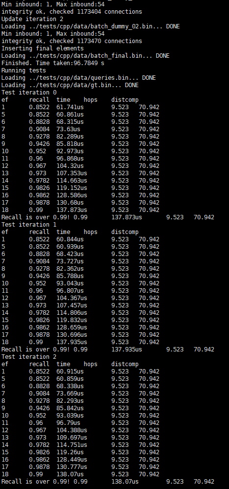

# 安装指南<a name="ZH-CN_TOPIC_0000002552742877"></a>

## 编译安装hnswlib<a name="ZH-CN_TOPIC_0000002549877861"></a>

### 已验证环境<a name="ZH-CN_TOPIC_0000002549757839"></a>

为保证您可以顺利安全地使用hnswlib，请确保所使用的环境信息在已验证环境范围内。

**表 1** hnswlib已验证环境<a id="hnswlib已验证环境"></a>

<a name="table4692134313211"></a>
<table><thead align="left"><tr id="row1169294312212"><th class="cellrowborder" valign="top" width="9.219078092190781%" id="mcps1.2.8.1.1"><p id="p116921643172119"><a name="p116921643172119"></a><a name="p116921643172119"></a>算法</p>
</th>
<th class="cellrowborder" valign="top" width="13.0986901309869%" id="mcps1.2.8.1.2"><p id="p863511211788"><a name="p863511211788"></a><a name="p863511211788"></a>包类型</p>
</th>
<th class="cellrowborder" valign="top" width="16.93830616938306%" id="mcps1.2.8.1.3"><p id="p12692144313211"><a name="p12692144313211"></a><a name="p12692144313211"></a>操作系统</p>
</th>
<th class="cellrowborder" valign="top" width="15.468453154684534%" id="mcps1.2.8.1.4"><p id="p06926438214"><a name="p06926438214"></a><a name="p06926438214"></a>CPU类型</p>
</th>
<th class="cellrowborder" valign="top" width="10.63893610638936%" id="mcps1.2.8.1.5"><p id="p269284310216"><a name="p269284310216"></a><a name="p269284310216"></a>内存</p>
</th>
<th class="cellrowborder" valign="top" width="13.468653134686532%" id="mcps1.2.8.1.6"><p id="p196922434215"><a name="p196922434215"></a><a name="p196922434215"></a>编译器</p>
</th>
<th class="cellrowborder" valign="top" width="21.16788321167883%" id="mcps1.2.8.1.7"><p id="p1769219435210"><a name="p1769219435210"></a><a name="p1769219435210"></a>其他</p>
</th>
</tr>
</thead>
<tbody><tr id="row1326345193910"><td class="cellrowborder" valign="top" width="9.219078092190781%" headers="mcps1.2.8.1.1 "><p id="p1922431816391"><a name="p1922431816391"></a><a name="p1922431816391"></a>hnswlib</p>
</td>
<td class="cellrowborder" valign="top" width="13.0986901309869%" headers="mcps1.2.8.1.2 "><p id="p5224111815393"><a name="p5224111815393"></a><a name="p5224111815393"></a>源码包</p>
</td>
<td class="cellrowborder" valign="top" width="16.93830616938306%" headers="mcps1.2.8.1.3 "><p id="p2225161819395"><a name="p2225161819395"></a><a name="p2225161819395"></a>openEuler 22.03 LTS SP3</p>
</td>
<td class="cellrowborder" valign="top" width="15.468453154684534%" headers="mcps1.2.8.1.4 "><p id="p1178432114216"><a name="p1178432114216"></a><a name="p1178432114216"></a>鲲鹏920 7282C处理器</p>
</td>
<td class="cellrowborder" valign="top" width="10.63893610638936%" headers="mcps1.2.8.1.5 "><p id="p20325717499"><a name="p20325717499"></a><a name="p20325717499"></a>16*32GB</p>
</td>
<td class="cellrowborder" valign="top" width="13.468653134686532%" headers="mcps1.2.8.1.6 "><p id="p13225618153916"><a name="p13225618153916"></a><a name="p13225618153916"></a>GCC 12.3.1</p>
</td>
<td class="cellrowborder" valign="top" width="21.16788321167883%" headers="mcps1.2.8.1.7 "><p id="p1031335541614"><a name="p1031335541614"></a><a name="p1031335541614"></a>CMake&gt;=3.22.0</p>
</td>
</tr>
</tbody>
</table>

**表 2** hnswlib已验证环境<a id="hnswlib已验证环境_1"></a>

<a name="table09590142055"></a>
<table><thead align="left"><tr id="row11959514551"><th class="cellrowborder" valign="top" width="9.219078092190781%" id="mcps1.2.8.1.1"><p id="p9959191410518"><a name="p9959191410518"></a><a name="p9959191410518"></a>算法</p>
</th>
<th class="cellrowborder" valign="top" width="14.028597140285973%" id="mcps1.2.8.1.2"><p id="p1295918146511"><a name="p1295918146511"></a><a name="p1295918146511"></a>包类型</p>
</th>
<th class="cellrowborder" valign="top" width="16.008399160083993%" id="mcps1.2.8.1.3"><p id="p109591714153"><a name="p109591714153"></a><a name="p109591714153"></a>操作系统</p>
</th>
<th class="cellrowborder" valign="top" width="15.468453154684534%" id="mcps1.2.8.1.4"><p id="p795901410513"><a name="p795901410513"></a><a name="p795901410513"></a>CPU类型</p>
</th>
<th class="cellrowborder" valign="top" width="10.63893610638936%" id="mcps1.2.8.1.5"><p id="p8959314652"><a name="p8959314652"></a><a name="p8959314652"></a>内存</p>
</th>
<th class="cellrowborder" valign="top" width="13.468653134686532%" id="mcps1.2.8.1.6"><p id="p119593143519"><a name="p119593143519"></a><a name="p119593143519"></a>编译器</p>
</th>
<th class="cellrowborder" valign="top" width="21.16788321167883%" id="mcps1.2.8.1.7"><p id="p15959114856"><a name="p15959114856"></a><a name="p15959114856"></a>其他</p>
</th>
</tr>
</thead>
<tbody><tr id="row3961151410518"><td class="cellrowborder" valign="top" width="9.219078092190781%" headers="mcps1.2.8.1.1 "><p id="p3961814659"><a name="p3961814659"></a><a name="p3961814659"></a>hnswlib</p>
</td>
<td class="cellrowborder" valign="top" width="14.028597140285973%" headers="mcps1.2.8.1.2 "><p id="p209611914650"><a name="p209611914650"></a><a name="p209611914650"></a>源码包</p>
</td>
<td class="cellrowborder" valign="top" width="16.008399160083993%" headers="mcps1.2.8.1.3 "><p id="p396116141055"><a name="p396116141055"></a><a name="p396116141055"></a>openEuler 24.03 LTS SP3</p>
</td>
<td class="cellrowborder" valign="top" width="15.468453154684534%" headers="mcps1.2.8.1.4 "><p id="p1696113141356"><a name="p1696113141356"></a><a name="p1696113141356"></a>鲲鹏950 7592C处理器</p>
</td>
<td class="cellrowborder" valign="top" width="10.63893610638936%" headers="mcps1.2.8.1.5 "><p id="p179617141654"><a name="p179617141654"></a><a name="p179617141654"></a>24*64GB</p>
</td>
<td class="cellrowborder" valign="top" width="13.468653134686532%" headers="mcps1.2.8.1.6 "><p id="p996118141510"><a name="p996118141510"></a><a name="p996118141510"></a>GCC 12.3.1</p>
</td>
<td class="cellrowborder" valign="top" width="21.16788321167883%" headers="mcps1.2.8.1.7 "><p id="p139618141551"><a name="p139618141551"></a><a name="p139618141551"></a>CMake&gt;=3.22.0</p>
</td>
</tr>
</tbody>
</table>


### 编译安装<a name="ZH-CN_TOPIC_0000002549877841"></a>

从GitHub和GitCode获取hnswlib开源代码和hnswlib补丁，应用补丁。

1. 获取开源代码，假设安装路径为“/path/to“。

    ```bash
    cd /path/to
    git clone -b v0.8.0 https://github.com/nmslib/hnswlib.git
    ```

2. 下载hnswlib的Patch文件，假设安装路径为“/path/to“。

    ```bash
    git clone https://gitcode.com/boostkit/hnswlib.git hnswlib-patch
    ```

3. 应用Patch。

    ```bash
    cd hnswlib
    patch -p1 < ../hnswlib-patch/0001-hnswlib_0.8.0-optimize-fp32_fp16_dis_idsort_prefetch.patch
    ```

4. 安装GCC 12.3.1与GCC-C++ 12.3.1。

    ```bash
    yum install gcc-toolset-12-gcc gcc-toolset-12-gcc-c++
    export PATH=/opt/openEuler/gcc-toolset-12/root/usr/bin/:$PATH
    export LD_LIBRARY_PATH=/opt/openEuler/gcc-toolset-12/root/usr/lib64/:$LD_LIBRARY_PATH
    ```

5. 安装OpenMP、CMake、Make。

    ```bash
    yum install cmake libgomp make
    ```

6. 安装HDF5库。

    ```bash
    yum install hdf5-devel
    ```


## 兼容性验证<a name="ZH-CN_TOPIC_0000002518398012"></a>

本章节提供在鲲鹏平台进行开源hnswlib兼容性验证的方法，包括获取hnswlib开源代码，编写测试脚本，执行测试脚本。

**测试源码目录说明<a name="section1198818518336"></a>**

假设程序运行的目录为“/path/to/hnswlib“，完整的目录结构应如下所示：

```text
├── examples/           // 功能测试文件
├── hnswlib/            // hnswlib头文件
├── python_bindings/    // python接口文件
├── tests/              // 功能测试文件
├── ALGO_PARAMS.md
├── CMakeLists.txt      // 功能测试CMakeLists.txt文件
├── LICENSE
├── Makefile            // 性能测试Makefile文件
├── MANIFEST.in
├── pyproject.toml
├── README.md
├── setup.py
└── TESTING_RECALL.md
```

**兼容性验证方法<a name="section1535217815349"></a>**

hnswlib是Hierarchical Navigable Small World（分层可导航小世界）图检索算法的开源实现，采用分层贪心搜索策略快速查找相似节点，广泛用于高效的近似最近邻搜索（Approximate Nearest Neighbor, ANN）。hnswlib的兼容性验证方法如下所示。

1. 下载hnswlib开源代码。

    ```bash
    git clone -b v0.8.0 https://github.com/nmslib/hnswlib.git
    cd /path/to/hnswlib
    ```

2. 修改CMakeLists.txt。
    1. 编辑CMakeLists.txt文件。

        ```bash
        vim CMakeLists.txt
        ```

    2. 将文件中的“-march=native“修改为“-march=armv8.2-a+dotprod“。
    3. 按“Esc“键，输入:**wq!**，按“Enter“保存并退出编辑。

3. 添加测试脚本。

    ```bash
    vim run.sh
    ```

    脚本文件的内容如下所示。

    ```bash
    rm -rf build
    mkdir build
    cd build
    cmake ..
    make
    cd ../tests/cpp
    python update_gen_data.py
    cd ../../build
    ./epsilon_search_test
    ./example_epsilon_search
    ./example_filter
    ./example_mt_filter
    ./example_mt_replace_deleted
    ./example_mt_search
    ./example_multivector_search
    ./example_replace_deleted
    ./example_search
    ./multiThreadLoad_test
    ./multiThread_replace_test
    ./multivector_search_test
    ./searchKnnCloserFirst_test
    ./searchKnnWithFilter_test
    ./test_updates
    ./test_updates update
    ```

4. 运行脚本，运行测试代码。

    ```bash
    sh run.sh
    ```

    测试结果如下图所示。

    


